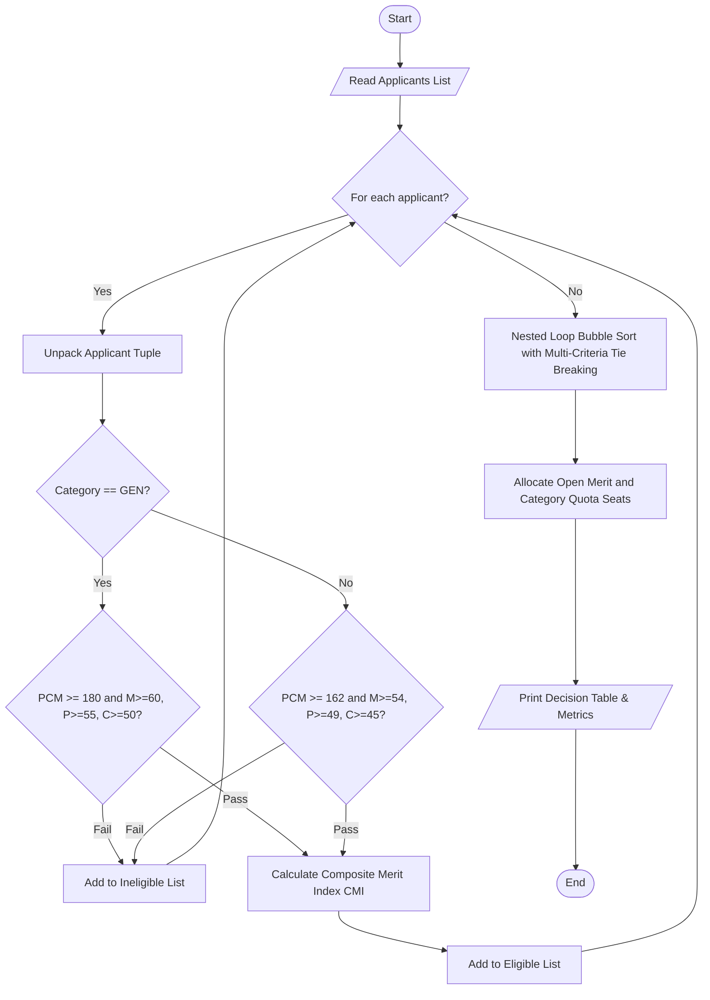

# Case Study 20: University Admission Decision Engine

## 1. Problem Statement
Design and implement an automated decision-support system for a competitive engineering university admissions board. The engine evaluates applicants based on their academic scores in Mathematics, Physics, and Chemistry (PCM), entrance examination rank, affirmative action category (`GEN`, `OBC`, `SC`, `ST`), and personal interview score. The system must verify subject and aggregate cutoff criteria with category-specific relaxations, compute a weighted Composite Merit Index (CMI), resolve rank ties using an ordered multi-criteria tie-breaking algorithm, and allocate available seats across Open Merit and Category Reserved quotas.

---

## 2. Objectives
- Accurately parse heterogeneous applicant records stored as tuples.
- Evaluate multi-tier conditional cutoff rules (both general and relaxed category rules).
- Calculate a normalized Composite Merit Index (CMI) combining board marks, entrance rank, and interview performance.
- Implement an in-place multi-criteria tie-breaking sorting algorithm without using external libraries, custom functions, or built-in lambda key functions.
- Allocate seats fairly following Open Merit and Category Quota rules.
- Strictly adhere to allowed core syllabus concepts: variables, operators, conditionals, loops, lists, and tuple unpacking.

---

## 3. Assumptions
- Applicant tuples follow the fixed format: `(applicant_id, name, math, physics, chemistry, entrance_rank, category, interview)`.
- Board marks are between 0 and 100. Interview scores are between 0 and 25. Entrance ranks are integers from 1 to 10,000 (lower rank number indicates superior performance).
- General Category cutoffs: PCM Total $\ge 180$, Math $\ge 60$, Physics $\ge 55$, Chemistry $\ge 50$.
- Reserved Categories (`OBC`, `SC`, `ST`) receive a 10% relaxation on cutoffs: PCM Total $\ge 162$, Math $\ge 54$, Physics $\ge 49$, Chemistry $\ge 45$.
- Tie-breaking hierarchy:
  1. Primary: Composite Merit Index (CMI) (descending).
  2. Tie-break 1: Mathematics score (descending).
  3. Tie-break 2: Physics score (descending).
  4. Tie-break 3: Interview score (descending).
  5. Tie-break 4: Entrance exam rank (ascending, i.e., lower numeric rank is better).

---

## 4. Algorithm
- **Step 1:** Initialize applicant records as a list of tuples.
- **Step 2:** Define seat quotas: `TOTAL_SEATS = 3`, `CATEGORY_RESERVED_SEATS = 1`, `OPEN_SEATS = 2`.
- **Step 3:** For each applicant record in the list:
  - Unpack `(applicant_id, name, math, physics, chemistry, rank, category, interview)`.
  - Check category-based eligibility criteria.
  - If eligible:
    - Compute $PCM\_Percentage = (math + physics + chemistry) / 3.0$.
    - Compute $Normalized\_Rank = (10000 - rank) / 100.0$.
    - Compute $Normalized\_Interview = (interview / 25.0) \times 100.0$.
    - Compute $CMI = (PCM\_Percentage \times 0.50) + (Normalized\_Rank \times 0.30) + (Normalized\_Interview \times 0.20)$.
    - Append evaluated tuple to `eligible_applicants`.
  - Else:
    - Append rejection reason to `ineligible_applicants`.
- **Step 4:** Sort `eligible_applicants` using nested loop comparison (Bubble Sort):
  - Compare adjacent candidates by CMI.
  - If CMI is equal, compare Math scores; if tied, compare Physics scores; if tied, compare Interview scores; if tied, compare Entrance Ranks.
  - Swap adjacent candidates if the successor has higher merit.
- **Step 5:** Traverse sorted merit list and allocate:
  - If open seats remain, allocate `ADMITTED (Open Merit)`.
  - Else if candidate belongs to reserved category and reserved seats remain, allocate `ADMITTED (Category Quota)`.
  - Otherwise, mark as `WAITLISTED`.
- **Step 6:** Display final tabular admission decision sheet and summary statistics.

---

## 5. Flowchart


---

## 6. Pseudocode
```text
BEGIN UniversityAdmissionEngine
    INITIALIZE applicants list
    SET TOTAL_SEATS = 3
    SET CATEGORY_SEATS = 1
    SET OPEN_SEATS = TOTAL_SEATS - CATEGORY_SEATS

    FOR EACH (id, name, m, p, c, rk, cat, intv) IN applicants:
        pcm = m + p + c
        IF cat == "GEN" THEN
            min_pcm = 180, min_m = 60, min_p = 55, min_c = 50
        ELSE
            min_pcm = 162, min_m = 54, min_p = 49, min_c = 45
        END IF

        IF pcm >= min_pcm AND m >= min_m AND p >= min_p AND c >= min_c THEN
            pcm_pct = pcm / 3.0
            norm_rank = (10000 - rk) / 100.0
            norm_intv = (intv / 25.0) * 100.0
            cmi = ROUND((pcm_pct * 0.50) + (norm_rank * 0.30) + (norm_intv * 0.20), 2)
            APPEND (cmi, m, p, intv, 10000 - rk, id, name, cat, pcm, rk) TO eligible_list
        ELSE
            APPEND (id, name, cat, reason) TO ineligible_list
        END IF
    END FOR

    // In-place Bubble Sort for multi-criteria tie-breaking
    FOR i FROM 0 TO LENGTH(eligible_list) - 2:
        FOR j FROM 0 TO LENGTH(eligible_list) - i - 2:
            IF eligible_list[j] should yield to eligible_list[j+1] on (CMI, Math, Physics, Intv, Rank) THEN
                SWAP eligible_list[j], eligible_list[j+1]
            END IF
        END FOR
    END FOR

    // Quota Allocation
    FOR EACH candidate IN eligible_list:
        IF open_count < OPEN_SEATS THEN
            status = "ADMITTED (Open Merit)"
            open_count = open_count + 1
        ELSE IF candidate.cat != "GEN" AND cat_count < CATEGORY_SEATS THEN
            status = "ADMITTED (Category Quota: " + candidate.cat + ")"
            cat_count = cat_count + 1
        ELSE
            status = "WAITLISTED"
        END IF
        RECORD decision
    END FOR

    PRINT decision table and metrics
END
```

---

## 7. Python Source Code
*Strictly adhering to syllabus constraints: loops, conditionals, lists, tuples, and unpacking only.*

```python
# Refer to solution.py in the same directory for complete executable script.
```

---

## 8. Test Cases

### Test Case 1: Standard Evaluation & Tie-Breaking
- **Inputs:**
  - `APP101`: Aarav Sharma (`GEN`, M: 88, P: 82, C: 75, Rank: 450, Interview: 22)
  - `APP103`: Chirag Verma (`GEN`, M: 92, P: 78, C: 75, Rank: 450, Interview: 22)
  - `APP105`: Divya Nair (`GEN`, M: 88, P: 82, C: 75, Rank: 450, Interview: 22)
- **Expected Outcome:**
  - All three achieve identical CMI = $87.08$.
  - Tie-break: `APP103` ranks #1 due to higher Mathematics score (92 vs 88).
  - `APP101` and `APP105` remain tied through Math and Physics; `APP101` takes Seat #2 (Open Merit), `APP105` is Waitlisted as Open Merit seats are exhausted.

### Test Case 2: Affirmative Action Category Cutoff Relaxation
- **Inputs:**
  - `APP102`: Bhavna Patel (`OBC`, M: 65, P: 58, C: 52, Rank: 1200, Interview: 20) $\rightarrow$ PCM = 175.
  - `APP104`: Deepak Rao (`SC`, M: 48, P: 50, C: 42, Rank: 3500, Interview: 15) $\rightarrow$ PCM = 140.
- **Expected Outcome:**
  - `APP102` is eligible under relaxed cutoff ($175 \ge 162$) and secures Category Quota seat.
  - `APP104` is rejected for failing the relaxed aggregate cutoff ($140 < 162$).

---

## 9. Output & Execution Log
```text
======================================================================
       UNIVERSITY ADMISSION DECISION ENGINE (Case Study 20)
======================================================================
[Loading Predefined Comprehensive Evaluation Dataset (5 Applicants)...]

----------------------------------------------------------------------
STAGE 1: ELIGIBILITY VERIFICATION
----------------------------------------------------------------------
  [ELIGIBLE]   APP101 - Aarav Sharma (GEN) | PCM: 245 | CMI: 87.08
  [ELIGIBLE]   APP102 - Bhavna Patel (OBC) | PCM: 175 | CMI: 71.57
  [ELIGIBLE]   APP103 - Chirag Verma (GEN) | PCM: 245 | CMI: 87.08
  [INELIGIBLE] APP104 - Deepak Rao (SC) | Reason: PCM aggregate 140 below cutoff (162.0)
  [ELIGIBLE]   APP105 - Divya Nair (GEN) | PCM: 245 | CMI: 87.08
  [ELIGIBLE]   APP106 - Esha Reddy (OBC) | PCM: 204 | CMI: 80.8

----------------------------------------------------------------------
STAGE 2: MULTI-CRITERIA TIE-BREAKING & MERIT RANKING
----------------------------------------------------------------------
Merit Ranking after Tie-Breaking:
  Rank 1: APP103 | Chirag Verma | Category: GEN | CMI: 87.08 [M:92, P:78, Rank:450]
  Rank 2: APP101 | Aarav Sharma | Category: GEN | CMI: 87.08 [M:88, P:82, Rank:450]
  Rank 3: APP105 | Divya Nair | Category: GEN | CMI: 87.08 [M:88, P:82, Rank:450]
  Rank 4: APP106 | Esha Reddy | Category: OBC | CMI: 80.8 [M:72, P:68, Rank:800]
  Rank 5: APP102 | Bhavna Patel | Category: OBC | CMI: 71.57 [M:65, P:58, Rank:1200]

----------------------------------------------------------------------
STAGE 3: SEAT ALLOCATION (Open Merit & Category Quota)
----------------------------------------------------------------------

======================================================================
FINAL UNIVERSITY ADMISSION DECISION SHEET
======================================================================
App ID   Candidate Name     Cat    CMI      Admission Decision
----------------------------------------------------------------------
APP103   Chirag Verma       GEN    87.08    ADMITTED (Open Merit)
APP101   Aarav Sharma       GEN    87.08    ADMITTED (Open Merit)
APP105   Divya Nair         GEN    87.08    WAITLISTED
APP106   Esha Reddy         OBC    80.80    ADMITTED (Category Quota: OBC)
APP102   Bhavna Patel       OBC    71.57    WAITLISTED
APP104   Deepak Rao         SC     N/A      REJECTED (PCM aggregate 140 below cutoff (162.0))
======================================================================
Total Processed: 6 | Eligible: 5 | Ineligible: 1
Total Admitted: 3 / 3 seats
======================================================================
```

---

## 10. Conclusion
Case Study 20 successfully models a real-world multi-dimensional admission decision pipeline. The solution demonstrates rigorous use of tuple unpacking, multi-conditional evaluation, nested loop sorting for multi-attribute tie-breaking, and quota partitioning, strictly without violating syllabus constraints.
